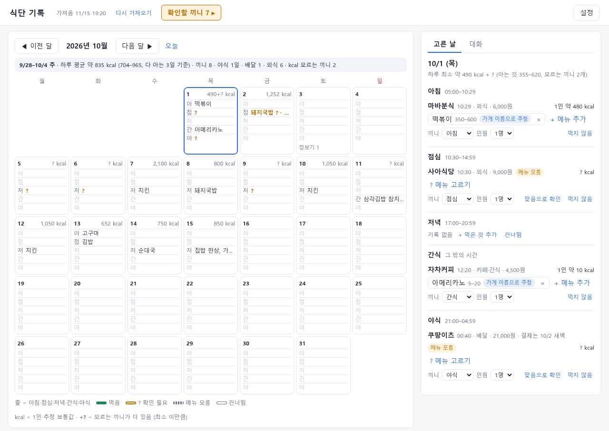
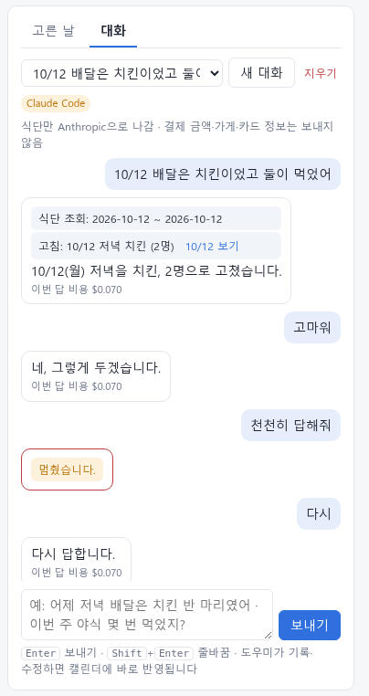
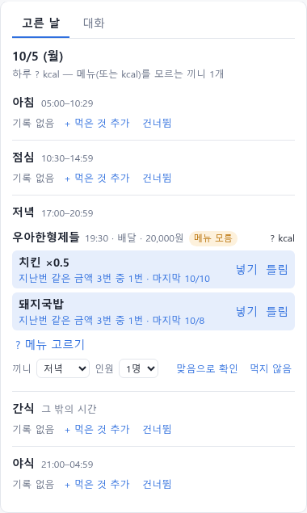
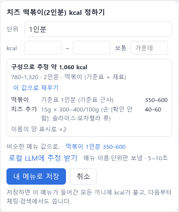

# meal_log — 카드 결제·영수증·대화로 채우는 식단 캘린더

식비 카드 결제를 끼니(아침·점심·저녁·간식·야식)로 나눠 캘린더에 놓고, 메뉴와 **kcal 범위와 그 근거**를 붙인다.
메뉴는 영수증·배달앱 캡처·한 줄 입력·대화로 채우고, 한 번 정한 메뉴는 같은 결제가 다시 나오면 제안으로 돌아온다.
정확한 숫자가 없는 메뉴("50개한정 제육덮밥(고기양300g)")는 이름을 풀어 밥·고기·양념으로 나눠 계산하고 계산 근거를 보여 준다.

- **로컬 전용**: 서버는 127.0.0.1에만 뜨고, 기록은 `data/meals.db`(SQLite 한 파일)에만 남는다.
  LLM은 이 PC의 로컬 서버만 쓴다. 예외는 사용자가 직접 고른 Claude 대화뿐이다 ([개인정보](#개인정보)).
- 쓰는 방법은 셋이다. **화면**(사람), **A2A**(다른 에이전트가 HTTP로 일을 맡김), **import**(파이썬). 셋 모두 같은 서비스 함수를 부른다.
- 한국어 메뉴·영수증·카드 데이터를 대상으로 한다.

## 화면


캘린더는 날짜마다 다섯 끼니를 줄로 보여 준다(`?` = 확인 필요). 오른쪽은 고른 날의 끼니별 가게·메뉴·kcal·인원이다.

| 대화 도우미 (세션 2종) | 지난번 같은 결제 제안 | 이름을 풀어 kcal 계산 |
|---|---|---|
|  |  |  |
| 말로 기록·수정·조회. 도구가 한 일은 카드로 보이고, 바뀐 날은 캘린더에 초록 테두리로 표시된다 | 메뉴 모르는 결제에 같은 앱·같은 금액으로 전에 확정한 메뉴를 제안한다 ([넣기]·[틀림]) | 밥 g × 쌀밥 100g당 + 고기 g × 재료 100g당 + 양념, 줄마다 근거 |

(캡처는 `python tools/browser_check.py`가 지어낸 데이터로 찍은 것이다.)

## 처음 쓰는 사람

```bash
# 세 저장소를 나란히 받는다 (meal_log가 ../doc_reader, ../basic_agent를 찾는다)
git clone https://github.com/Taeksu-Kim/meal_log
git clone https://github.com/Taeksu-Kim/doc_reader            # 필수: doc_parser (OCR 클라이언트·A2A 창구)
git clone https://github.com/Taeksu-Kim/basic_agent           # 선택: 로컬 LLM 호출 (없으면 LLM 기능만 잠김)

cd meal_log
pip install -e ../doc_reader                                 # python 3.11+
pip install -r requirements.txt
python -m meal_log serve                                     # http://127.0.0.1:8766  ("localhost" 말고 이 주소)
```

처음 열면 빈 캘린더가 나온다. 카드 결제 원천이 없어도 다음은 모두 된다.
- 한 줄 입력("오늘 아침에 고구마 1개 먹었어")
- 날짜를 눌러 끼니 추가
- 영수증·캡처 올리기
- 대화 도우미

### 켜면 열리는 기능 (모두 선택, 꺼져 있어도 서버는 뜨고 그 기능만 잠기며 켜는 법이 화면에 나온다)

| 외부 의존 | 열리는 기능 | 켜는 법 | 기본 주소 |
|---|---|---|---|
| 카드 결제 원천 (card_spending 호환 API) | 식비 결제 → 끼니 자동 배치, 열 때마다 새 결제 가져오기 | 아래 [카드 결제 원천](#카드-결제-원천) | `--card-url http://127.0.0.1:8765` |
| OCR 서버 (doc_reader) | 영수증·배달앱 캡처·영양정보 라벨 읽기 | `bash ../doc_reader/doc_parser/tools/ocr.sh start` (GPU 약 5~8GB) | `--ocr-url http://127.0.0.1:8090` |
| 로컬 LLM (OpenAI 호환, 예: vLLM + Qwen) | 어려운 문장 해석, kcal 추정, 대화 도우미 "로컬 LLM" 세션 | vLLM 등으로 OpenAI 호환 서버를 띄움 + basic_agent | `--llm-url http://127.0.0.1:8002/v1` |
| Claude Code (`claude` 명령, 로그인) | 대화 도우미 "Claude Code" 세션 | [Claude Code](https://claude.com/claude-code) 설치·로그인 | — |

- OCR 서버와 27B급 로컬 LLM은 GPU 24GB 한 장에 같이 올리기 어렵다. OCR은 이미지를 올릴 때만 필요하다(읽은 글자는 DB에 남는다).
  그래서 평소에는 LLM을 켜 두고, 사진을 올릴 때만 OCR로 바꾸면 된다.
- 로컬 LLM은 Qwen3 계열에서 시험했다. 요청마다 thinking을 끄고(`enable_thinking: false`) 답을 JSON 스키마로 받는다.

옵션: `python -m meal_log serve --db data/meals.db --port 8766 --card-url … --llm-url … --ocr-url …`

## 쓰는 흐름

매일 열어도 되고, 생각날 때 몇 주 만에 열어도 같은 흐름이다.

1. **열면 카드 결제를 가져와 끼니로 나눈다.** 결제 시각으로 끼니를 정하고(아래 [규칙](#끼니-나누기-규칙)), 가게 이름으로 메뉴를 짐작한다
   ("가나김밥" → 김밥, 화면에 "가게 이름으로 추정"). 배달 결제는 결제 이름이 배달앱이라 메뉴를 모르는 채로 들어온다.
2. **머리글의 "확인할 끼니 n ▸"** 를 누르면 가장 오래된 것부터 하나씩 연다.
   - 메뉴를 고르면 다음 끼니로 넘어간다.
   - 지난번 같은 결제의 제안이 있으면 [넣기] 한 번으로 끝난다.
   - 인원(둘이 먹음), "먹지 않음", 끼니 옮기기도 여기서 한다.
   - 모든 변경은 알림 줄의 **되돌리기**로 취소된다.
3. **먹은 것 적기** (화면 위 입력 줄):
   - "어제 저녁 배달은 치킨 반 마리였어"처럼 적으면 미리보기를 보여 주고, Enter를 한 번 더 누르면 넣는다.
   - 날짜를 말하지 않으면 옆 날짜 칸(기본 오늘)으로 넣는다.
   - 같은 날·끼니에 메뉴 모르는 카드 결제가 있으면 그 결제를 채운다.
   - 규칙으로 안 풀리는 문장(끼니 여럿, 요일, 애매한 말)은 로컬 LLM이 해석한다.
4. **영수증·캡처 올리기** (버튼 또는 끌어다 놓기, 여러 장 가능). 결과는 "확인할 캡처" 카드로 뜨고, 고친 뒤 [확정]하면 반영된다.
   - **배달 영수증·종이 영수증**: 가게·일시·결제금액·품목을 읽고, 금액이 같고 날짜가 맞는 카드 결제와 짝짓는다(배달은 ±1일).
     옵션 중 돈을 낸 음식은 "곁들임"으로 넣는다. 가려져 잘못 읽힌 달은 적힌 요일로 바로잡는다("1월 12일 (목)" → 11/12).
   - **배달앱 주문상세 화면**: 메뉴 덩어리(이름 → 옵션 → "17,000원 1개")를 읽는다.
     날짜·결제금액이 화면 밖이면 메뉴금액 + 배달팁으로 추정해 후보를 최근 순으로 보여 준다(할인됐을 수 있는 금액도 표시).
     **결제 정보까지 담아 길게 캡처**하면 한 건으로 정확히 짝지어진다.
   - **영양정보 라벨** (포장 식품): 제품명·총 내용량·kcal을 읽어 내 메뉴로 저장한다.
     이후 "닭다리 양념 스테이크랑 양파 하나 먹었어"처럼 적으면 된다(띄어쓰기·어순이 달라도 맞춘다).
5. **kcal을 모르는 메뉴**는 "kcal 모름 · 정하기"(또는 캡처 칩의 "구성 추정 약 … · 확인")를 누른다.
   - 상자에서 고를 수 있는 것:
     - **구성으로 추정**: 이름을 풀어 계산, 줄별 근거
     - **비슷한 메뉴 값으로**
     - **로컬 LLM에 추정 받기**
     - 직접 입력
   - [내 메뉴로 저장]하면 그 메뉴가 든 모든 끼니에 kcal이 붙고, 채팅·검색에서도 아는 메뉴가 된다.
6. **대화 탭** (오른쪽 칸): "이번 주 야식 몇 번 먹었지?", "메뉴 모르는 끼니 정리 도와줘", "어제 저녁은 둘이 먹었어".
   대화를 시작할 때 세션을 고른다.
   - **로컬 LLM** (기본, 이 PC 안에서만)
   - **Claude Code** (식단만 Anthropic으로 나감, 답마다 비용 표시)

   두 세션은 같은 도구 7개와 같은 지침(`assistant/GUIDE.md`)을 쓴다. 기록은 확실할 때만 하고, 끼니·수량이 빠지면 되묻는다.
   대화는 DB에 남아 재시작 후에도 이어진다.
7. **오래 안 열어서 확인할 끼니가 쌓였으면** 머리글의 "○/○ 이전은 모름으로 두기"를 누른다.
   그 날짜(정리 기준일) 이전의 메뉴 모르는 끼니는 확인 목록에서 빠지고 "모름"으로 남는다(기록은 그대로, 설정에서 바꿈).

## kcal은 어떻게 나오나

- 항상 **1인 기준 범위(낮음–높음, 보통)** 로 보여 준다. 끼니 kcal = 메뉴 kcal × 수량 합 ÷ 인원.
- **모르는 끼니는 0으로 치지 않는다.** 아는 것만 더하고 "+?"를 붙인다(날짜 칸 `490+? kcal`, "하루 최소 약 490 kcal + ?").
  주별 하루 평균은 그날 끼니를 모두 아는 날로만 낸다(모르는 끼니가 섞인 날은 실제보다 낮게 나와서 뺀다).
- 값의 출처는 화면에서 칩에 마우스를 올리면 보인다.

| 출처 | 내용 |
|---|---|
| 식약처 DB | 식약처 "전국통합식품영양성분정보(음식)"의 외식 1인분 값 (기준표 83개 중 16개, `tools/kcal_db_compare.py`) |
| 기준표 근사 | 손으로 적은 근사값 (나머지 67개) |
| 구성 계산 | 이름을 풀어 계산 — 덮밥·볶음밥·비빔밥은 밥 + 토핑 + 양념, 떡볶이·짬뽕·국수 등은 기준표 값 + 앞말 재료. 재료 100g당 값은 식약처 DB 행에서 옮겼고 줄마다 근거 행이 보인다. 모르는 말이 섞이면 "대략" |
| 포장지 영양정보 | 라벨 사진에서 읽은 값 |
| LLM 추정 | 로컬 LLM이 비슷한 기준 메뉴를 참고해 낸 범위 (사람이 보고 저장) |
| 직접 정함 | 사람이 넣은 값 |

kcal은 경향을 보는 추정이다. 정확도(이번 저장소에서 잰 값, 2026-11-15)는 다음과 같다.
- **구성 계산**: 식약처 DB의 복합 메뉴를 이름만으로 추정했을 때, 이름을 다 이해한 경우 오차 중앙 17%, 정답이 범위 안 8/11이다.
- **LLM 추정**: 참고 기준을 주면 오차 중앙 11%, 범위 안 10/16이다.
- 규칙을 같은 세트로 고친 값이라 새 메뉴에서는 더 나쁠 수 있다. 자세한 내용은 `DESIGN.md`에 있다.

## 끼니 나누기 규칙

- 시간대(설정에서 바꿈): 아침 05:00–10:29 · 점심 10:30–14:59 · 저녁 17:00–20:59 · 야식 21:00–04:59 · 그 밖 = 간식
- **하루의 시작 = 아침 시작 시각.** 그보다 이른 결제는 전날 기록이다(자정 넘은 야식 → 전날 야식, 화면에 "결제는 ○/○ 새벽").
- 카페·편의점 → 간식 (10,000원 이상이면 그 시간대 끼니), 마트 → "장보기" (먹은 끼니 아님)
- 같은 소분류 결제 중앙값의 2배 이상인 배달·외식은 "인원 확인"으로 띄운다.
- 사람이 고친 값은 다시 가져와도 덮어쓰지 않는다. 대상은 끼니 옮김, 메뉴, 인원, 먹지 않음이다.

## 개인정보

- 기록·올린 이미지·대화는 `data/`에만 저장되고, `data/`는 git에서 제외된다.
- 로컬 LLM(이 PC)에는 다음만 보낸다. 결제 금액·가게·카드 정보는 보내지 않는다.
  - 입력한 문장
  - 메뉴 이름 목록
  - 메뉴 이름·단위
  - 대화 도우미 도구 결과(식단만)
- **Claude Code 세션을 고른 대화만** 대화 내용과 식단(끼니·메뉴·수량·kcal·인원)이 Anthropic으로 나간다.
  결제 금액·가게·카드 범주·결제일은 도구 결과에서 걸러진다(`chat_tools._meal` 한 곳, `tests/test_assistant.py`가 지킨다).
  Claude 세션은 파일·셸·웹 도구 없이 meal_log 도구만 쓴다: `--tools ""`에 MCP 다리 하나, 개발용 설정·CLAUDE.md는 싣지 않음.
- 테스트·점검·문서의 가게·메뉴·금액은 모두 지어낸 값이다.

## 다른 에이전트가 쓰기 (A2A) · import

- **A2A 1.0** (같은 서버, 127.0.0.1만):
  - 카드 `GET /.well-known/agent-card.json`, 창구 `POST /a2a` (JSON-RPC: SendMessage·GetTask·ListTasks·CancelTask).
  - 기능:
    - `log-meal`: 문장 → 기록. 끼니·수량이 모자라면 INPUT_REQUIRED로 되묻는다.
    - `read-receipt`: 이미지 → 확인할 캡처. 사람이 화면에서 확정하면 COMPLETED.
    - `query-meals`
    - `sync-card`
  - 결과에는 사람이 확인할 화면 링크 `metadata.reviewUrl`이 붙는다. A2A로 넣은 끼니·캡처는 화면에 "A2A"로 보이고 이어서 고칠 수 있다.
- **import**: `from meal_log.service import MealService` (화면·A2A가 부르는 그 함수들), `from meal_log import compose, receipts, chat`
  (단계별 엔진: 이름 → kcal 계산, OCR 글자 → 영수증, 문장 → 끼니).

## 카드 결제 원천

meal_log는 카드 앱의 HTTP API를 읽기만 한다(저자의 card_spending 앱, 공개 안 됨). 같은 모양을 내는 서버면 무엇이든 붙는다.
- `GET /api/period` → `{"start": "YYYY-MM-DD", "end": "YYYY-MM-DD", …}` (저장된 결제 기간. 이 안에서 사라진 결제 = 취소로 본다)
- `GET /api/transactions?majors=식비&month=YYYY-MM` → `{"rows": [...], "truncated": bool, …}`. 한 행의 필드는 다음과 같다.
  - `date`·`time`: 결제 날짜·시각
  - `name`·`raw`: 가게 이름(정리한 것·원래)
  - `krw`·`usd`·`amount`: 금액
  - `method`: 결제수단
  - `category`: `"식비 › 배달"`처럼 대분류 › 소분류. 소분류는 배달·외식·카페·간식·편의점·마트·장보기 등
  - `source`, `merchant_key`
- 정확한 모양은 가짜 원천 `tests/fake_card.py`를 보면 된다. 결제 id가 없어서 날짜·시각·원래 이름·금액·결제수단으로 키를 만든다.

## 개발

```bash
python -m pytest -q                   # API·A2A 진입점 테스트 (외부 의존은 가짜: 카드·OCR·LLM·claude)
python tools/browser_check.py         # 실제 Chromium 점검 (지어낸 데이터, 임시 DB) — 화면을 바꾸면 돌린다 (playwright install chromium)
```

정확도 도구 (실제 서버나 내려받은 파일이 필요):

| 도구 | 재는 것 |
|---|---|
| `tools/chat_eval.py` | 문장 해석 (로컬 LLM, 지어낸 문장) |
| `tools/assistant_eval.py` | 대화 도우미 로컬 세션 — 답 문장이 아니라 DB에 기록이 맞게 바뀌었는지 (로컬 LLM, 지어낸 대화) |
| `tools/kcal_estimate_eval.py` | LLM kcal 추정, 참고 기준 없이 vs 있게 (로컬 LLM) |
| `tools/compose_eval.py <음식 DB xls>` | 구성 계산 vs 식약처 DB (data.go.kr에서 내려받은 파일) |
| `tools/kcal_db_compare.py <음식 DB xls>` | 기준표 값 vs 식약처 DB |
| `tools/capture_eval.py` | 영수증·라벨 읽기 (OCR 서버, `data/eval_captures/`의 사진 + 사람이 적은 정답) |
| `tools/memory_eval.py` | 지난번 같은 결제 제안이 맞는지 — 확정 기록을 시간순으로 다시 돌림 (집계만 출력) |

설계와 결정의 근거는 `DESIGN.md`, 작업 규칙은 `CLAUDE.md`에 있다.

## 폴더

```
meal_log/   service.py   상태를 다루는 모든 동작 (화면 API·A2A·대화 도구 공용, SQLite 한 파일)
            app.py       화면 API (FastAPI)          a2a_tasks.py  A2A 창구          __main__.py  serve
            store.py     SQLite                     sources.py    카드 결제 원천 API  slots.py     끼니 규칙
            analysis.py  kcal·확인 이유·캘린더·주별     menu_kcal.py  kcal 기준표·가게→메뉴 규칙
            compose.py   이름을 풀어 kcal 계산         memory.py     지난번 같은 결제 제안
            receipts.py  OCR 글자 → 영수증·주문상세·라벨, 카드 결제와 짝짓기
            chat.py      문장 해석 (규칙 → 로컬 LLM)    suggest.py    LLM kcal 추정       llm.py  로컬 LLM 연결
            chat_tools.py 대화 도우미 도구 (식단만)     chat_backends.py 세션 2종 (Claude Code / 로컬 LLM)
            mcp_bridge.py Claude 세션용 MCP 다리       static/index.html 화면 한 장
assistant/  GUIDE.md     대화 도우미 지침 (두 세션 공용)
tests/      API·A2A 진입점 테스트 + 가짜 카드 원천       tools/  브라우저 점검·정확도 도구
data/       meals.db · captures/ · eval_captures/  — git 제외
```

## 라이선스

Apache License 2.0 — `LICENSE`, 의존 소프트웨어와 데이터 출처는 `NOTICE`.
